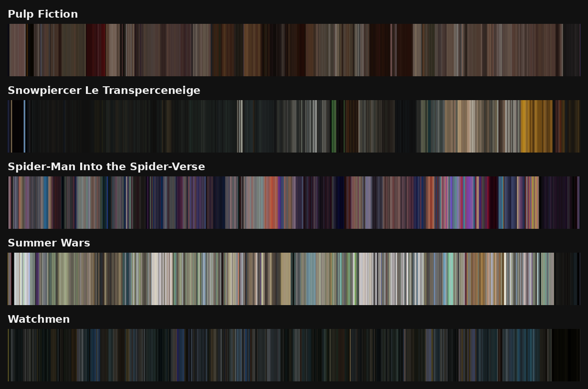
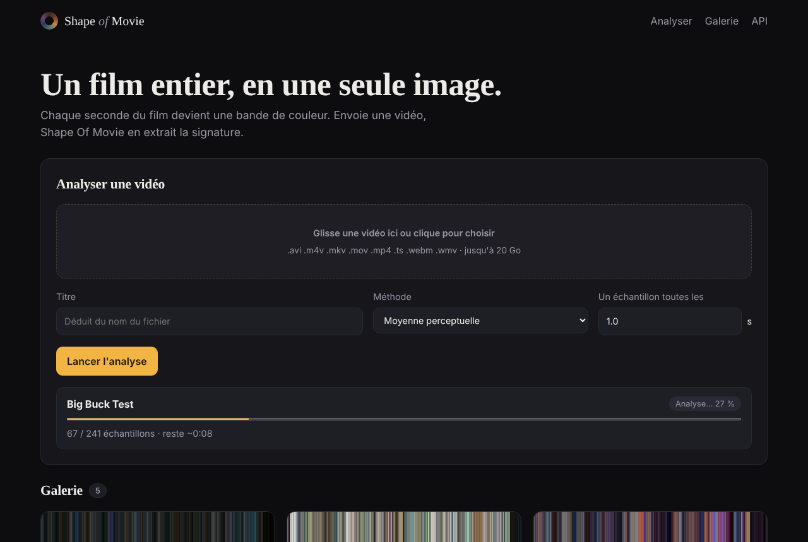
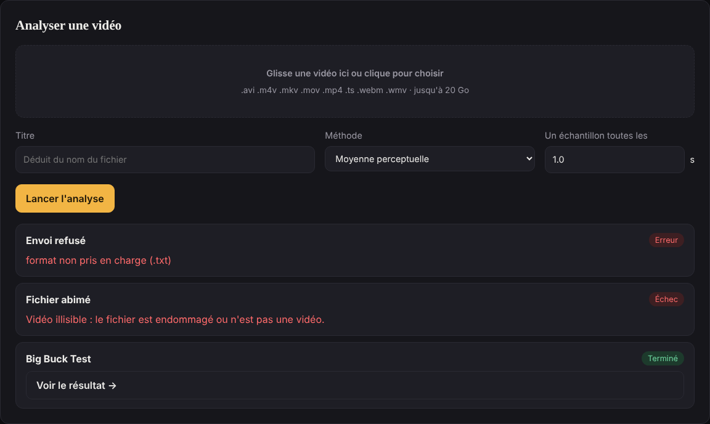
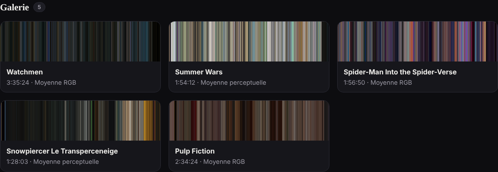
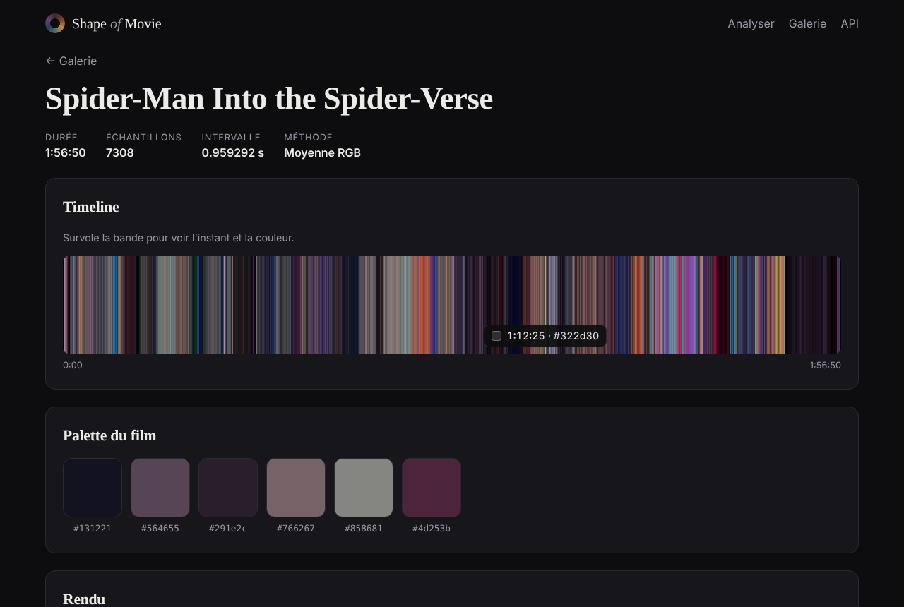
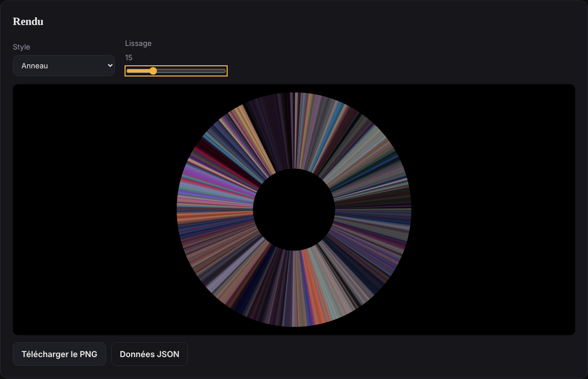
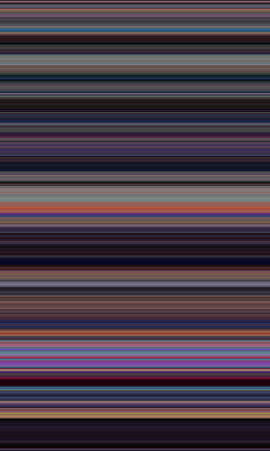
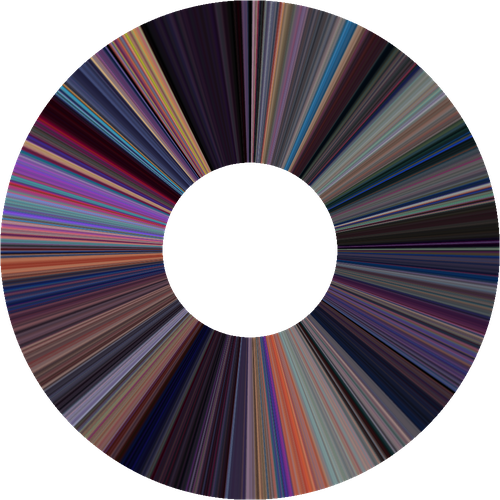
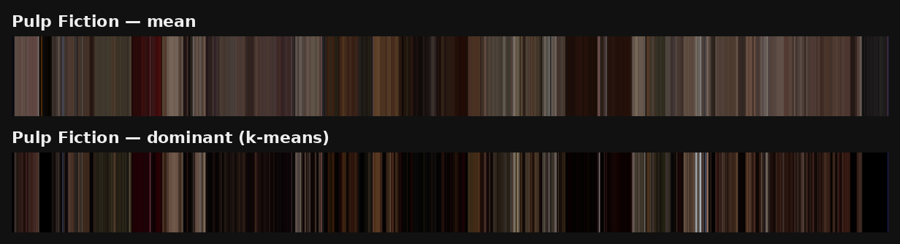

# 🎞️ Shape Of Movie

[](https://github.com/Fyndir/ShapeOfMovie/actions/workflows/ci.yml)


**🌐 Démo en ligne : https://fyndir.github.io/ShapeOfMovie/**

**Résumer un film entier en une seule image.** Shape Of Movie échantillonne une image par seconde, la réduit à une couleur, puis aligne toutes ces couleurs dans l'ordre chronologique : l'ambiance, les scènes de nuit, les changements de décor apparaissent d'un coup d'œil.



> Projet né en DUT en 2020, entièrement réécrit en 2026. Il s'utilise en **ligne de commande** ou via une **interface web**. Prochaines étapes : la connexion à Jellyfin et un jeu « devine le film » (voir la [feuille de route](#-feuille-de-route)).

---

## ✨ Fonctionnalités

| | |
|---|---|
| 🎬 **Analyse de vidéos** | `.mkv`, `.mp4`, `.avi`, `.mov`, `.webm`… fichier seul ou dossier entier (récursif). Fonctionne aussi sur une URL de flux. |
| ⚡ **Rapide et sans fichiers temporaires** | ffmpeg décode et réduit les images en une seule passe, les pixels arrivent directement en mémoire. Environ 20× plus rapide que le temps réel sur du 1080p (≈ 5 min pour un film de 2 h). |
| 🎨 **4 méthodes de couleur** | moyenne, moyenne en lumière linéaire, médiane, couleur dominante (k-means). |
| 🖼️ **3 styles de rendu** | code-barres horizontal, bandes verticales, anneau. Taille libre et lissage optionnel. |
| 💾 **Format JSON léger** | une couleur hexadécimale par échantillon + métadonnées. Les fichiers de la version 2020 restent lisibles. |
| 🔁 **Reprise sûre** | les films déjà analysés sont ignorés ; un fichier n'est écrit qu'une fois l'analyse terminée. |
| 🌐 **Interface web** | envoi de vidéos, analyse en arrière-plan avec progression en direct, galerie, timeline interactive, palette, export PNG/JSON. |
| 🔌 **API REST** | les mêmes fonctions en JSON, documentées automatiquement (`/docs`). |
| 📋 **Logs** | console et fichier, niveau réglable, pour la CLI comme pour le serveur. |
| 🐳 **Docker** | une image prête à déployer, ffmpeg inclus. |
| 📦 **Site statique** | une vitrine en lecture seule, hébergeable gratuitement (GitHub Pages…). |

---

## 🚀 Installation

Prérequis : Python ≥ 3.11 et [ffmpeg](https://ffmpeg.org/download.html) dans le `PATH`.

```bash
git clone https://github.com/Fyndir/ShapeOfMovie.git
cd ShapeOfMovie
pip install -e ".[kmeans,web]"  # [kmeans] : méthode "dominant" · [web] : interface web
```

Ou directement avec Docker (ffmpeg inclus) :

```bash
docker build -t shapeofmovie .
docker run -d -p 8000:8000 -v som-data:/data shapeofmovie
```

## 🌐 Interface web

```bash
shapeofmovie serve --port 8000 --data ./data
```

Puis ouvrir http://127.0.0.1:8000.

### Accueil : envoyer une vidéo

On glisse une vidéo (ou on clique pour la choisir), on choisit éventuellement un titre, une méthode et l'intervalle d'échantillonnage. Une barre suit l'envoi du fichier, puis l'analyse tourne en arrière-plan : progression, nombre d'échantillons et temps restant se mettent à jour toutes les secondes. Plusieurs analyses peuvent être en file d'attente. **La vidéo est supprimée du serveur dès que l'analyse est finie** : seule sa signature (quelques dizaines de Ko) est conservée.



Les erreurs sont signalées clairement : un format refusé est bloqué dès l'envoi, et une vidéo endommagée fait échouer sa tâche sans gêner les autres. Le détail technique reste dans les logs du serveur.



### Galerie

Chaque film analysé apparaît dans la galerie, qui se met à jour seule quand une analyse se termine.



### Page d'un film

- **Timeline interactive** : on survole la bande pour lire l'instant exact et la couleur à ce moment.
- **Palette** : les 6 couleurs qui résument le mieux le film.
- **Rendu** : choix du style et du lissage avec aperçu immédiat, téléchargement en PNG haute définition ou des données en JSON.
- Suppression du film.





### Configuration

Variables d'environnement, toutes facultatives :

| Variable | Défaut | Rôle |
|---|---|---|
| `SOM_DATA_DIR` | `./data` | dossier des analyses (`shapes/`) et des envois en cours (`uploads/`) |
| `SOM_MAX_UPLOAD_MB` | `20000` | taille maximale d'une vidéo, en Mo |
| `SOM_WORKERS` | `1` | nombre d'analyses en parallèle |
| `SOM_DEFAULT_METHOD` | `linear` | méthode sélectionnée par défaut |
| `SOM_DEFAULT_STEP` | `1.0` | intervalle par défaut, en secondes |
| `SOM_LOG_LEVEL` | `INFO` | niveau des logs (voir [Logs](#-logs)) |
| `SOM_LOG_FILE` | | fichier de logs en plus de la console |

> Aucune authentification pour l'instant : à exposer derrière un reverse proxy protégé (ou à garder sur le réseau local) en attendant la connexion via Jellyfin.

### API

La documentation interactive est servie sur `/docs`.

| Méthode | Route | Rôle |
|---|---|---|
| `POST` | `/api/analyses` | envoie une vidéo (`file`, `title`, `method`, `step`) → tâche `202` |
| `GET` | `/api/jobs/{id}` | état d'une tâche : `queued`, `running`, `done`, `error`, avancement |
| `GET` | `/api/movies` | liste des films analysés |
| `GET` | `/api/movies/{id}` | détail d'un film, palette et couleurs |
| `GET` | `/movies/{id}/image.png` | rendu (`style`, `width`, `height`, `smooth`) |
| `GET` | `/movies/{id}/shape.json` | données brutes |
| `DELETE` | `/movies/{id}` | supprime un film |

```bash
curl -F file=@"Pulp Fiction.mkv" -F method=linear localhost:8000/api/analyses
```

---

## 📦 Site statique (GitHub Pages)

GitHub Pages ne sert que des fichiers statiques : il ne peut pas faire tourner le serveur, donc ni l'envoi de vidéos ni l'analyse. La commande `site` produit à la place une **vitrine en lecture seule** à partir d'analyses existantes. On y retrouve la galerie, les pages de films avec la timeline interactive, la palette et les rendus (pré-calculés), avec le même design que l'application.

```bash
shapeofmovie site shapes/ -o site/ --base-path /ShapeOfMovie/
```

- Tous les liens sont relatifs : le site fonctionne à la racine d'un domaine comme dans un sous-dossier.
- `--base-path` ne sert qu'à la page 404.

À chaque push sur `master`, le workflow [`pages.yml`](.github/workflows/pages.yml) génère le site à partir de [`examples/mean`](examples/mean) et le publie sur https://fyndir.github.io/ShapeOfMovie/. Pour l'activer : **Settings → Pages → Source : GitHub Actions** (une seule fois).

---

## 🛠️ Ligne de commande

Le travail se fait en deux temps : **analyser** les vidéos (long, une seule fois) puis **dessiner** autant de rendus qu'on veut à partir des JSON (instantané).

### 1. Analyser

```console
$ shapeofmovie analyze ~/Vidéos/Films -o shapes/ --method linear
analyse Pulp Fiction.mkv
   37% (3573/9657)
```

| Option | Défaut | Rôle |
|---|---|---|
| `-o, --output` | `shapes/` | dossier des fichiers JSON |
| `-m, --method` | `mean` | `mean`, `linear`, `median` ou `dominant` |
| `-s, --step` | `1` | secondes entre deux échantillons |
| `-f, --force` | | ré-analyse même si le JSON existe déjà |

### 2. Dessiner

```console
$ shapeofmovie render shapes/ -o images/ --style ring --width 800 --smooth 9
Pulp Fiction.linear.json -> images/Pulp Fiction.linear.ring.png
```

| Option | Défaut | Rôle |
|---|---|---|
| `--style` | `barcode` | `barcode`, `vertical` ou `ring` |
| `--width` / `--height` | `1920` / `1080` | taille de l'image (l'anneau est carré, `--height` ignoré) |
| `--smooth` | `0` | fenêtre de moyenne glissante, en échantillons |

### Depuis Python

```python
from shapeofmovie import analyze, render

shape = analyze("Pulp Fiction.mkv", method="linear", step=1.0)
shape.save("pulp.json")
render(shape, style="ring", width=800).save("pulp.png")
```

---

## 🖼️ Styles de rendu

**`barcode`** : le temps s'écoule de gauche à droite.


| **`vertical`** : de haut en bas (le rendu de la version d'origine) | **`ring`** : dans le sens horaire, depuis midi |
|:---:|:---:|
|  |  |

**`--smooth`** atténue le scintillement des changements de plan (à gauche brut, à droite `--smooth 30`) :


## 🎨 Méthodes de couleur

| Méthode | Principe | Résultat |
|---|---|---|
| `mean` | moyenne des valeurs RGB | fidèle à la luminosité globale, un peu terne |
| `linear` | moyenne en lumière linéaire (sRGB → linéaire → sRGB) | proche du mélange perçu par l'œil, moins « boueux » |
| `median` | médiane par canal | ignore les petites zones très claires ou très sombres |
| `dominant` | plus gros groupe d'un k-means (k = 5) | la couleur qui occupe le plus de surface : plus contrasté, plus lent |



---

## 📋 Logs

La ligne de commande et le serveur partagent le même système de logs (module standard `logging`), écrit sur la sortie d'erreur et, en option, dans un fichier qui tourne à 10 Mo (5 fichiers conservés).

| Réglage | Option CLI | Variable |
|---|---|---|
| Niveau : `DEBUG`, `INFO` (défaut), `WARNING`, `ERROR` | `--log-level` | `SOM_LOG_LEVEL` |
| Fichier | `--log-file` | `SOM_LOG_FILE` |

```console
$ shapeofmovie --log-file logs/som.log analyze "Pulp Fiction.mkv"
2026-11-16 15:44:11 INFO    shapeofmovie.analyze: analysing Pulp Fiction.mkv (1920x1080, 9264 s) method=mean step=1.0s
2026-11-16 15:51:52 INFO    shapeofmovie.analyze: analysed Pulp Fiction.mkv: 9265 samples in 461.0 s, 20.1x realtime
```

Ce qui est journalisé :
- **analyse** : début (résolution, durée, réglages), fin (nombre d'échantillons, durée, vitesse), commande ffmpeg exacte en `DEBUG`, erreurs ffmpeg ;
- **serveur** : démarrage, requêtes (journal d'accès uvicorn), envois reçus ou refusés, cycle de vie de chaque analyse (`queued`, `started`, `done` ou erreur avec la trace), films enregistrés et supprimés, requêtes lentes (> 2 s) et erreurs 5xx.

Avec Docker : `docker logs <conteneur>`, ou `-e SOM_LOG_FILE=/data/logs/som.log` pour garder un fichier dans le volume.

---

## 📄 Format JSON

```json
{
  "version": 2,
  "title": "Pulp Fiction",
  "method": "linear",
  "step": 1.0,
  "duration": 9216.4,
  "source": "/films/Pulp Fiction.mkv",
  "meta": {},
  "colors": ["1d1a17", "2b2420", "..."]
}
```

L'échantillon `i` correspond à l'instant `i × step` secondes. `meta` est libre (il accueillera par exemple l'identifiant Jellyfin). Les dix analyses d'origine sont fournies dans [`examples/`](examples/). Leur pas est de 0,959 s et non 1 s : la version de 2020 arrondissait 23,976 images/s à 23.

---

## 🧩 Architecture

```
src/shapeofmovie/
├── extract.py   # ffprobe / ffmpeg : échantillonnage des images, sans fichier temporaire
├── colors.py    # méthodes image → couleur
├── analyze.py   # pipeline vidéo → MovieShape, avec suivi de progression
├── logs.py      # configuration des logs (console + fichier)
├── models.py    # MovieShape + lecture/écriture JSON (compatible v1)
├── render.py    # MovieShape → image (barcode, vertical, ring)
├── site.py      # export du site statique (+ site_templates/)
├── cli.py       # commandes `analyze`, `render`, `serve` et `site`
└── web/
    ├── app.py       # FastAPI : pages HTML et API JSON
    ├── jobs.py      # file d'analyses en arrière-plan
    ├── store.py     # stockage des analyses (un JSON par film)
    ├── config.py    # réglages SOM_*
    ├── templates/   # Jinja + HTMX
    └── static/      # CSS, htmx, timeline interactive (JS sans framework)
```

Le moteur n'a aucune dépendance à une interface : la ligne de commande et l'application web ne font que l'appeler. Côté web, tout est rendu par le serveur ; HTMX gère les mises à jour partielles (progression, galerie, aperçu) et un petit script dessine la timeline.

## 🧪 Développement

```bash
pip install -e ".[dev]"
playwright install chromium          # une fois, pour les tests navigateur
pytest                               # tout : unitaires, API, CLI et navigateur
pytest -m "not e2e"                  # sans navigateur
ruff check . && ruff format --check .
python scripts/build_readme_images.py   # régénère les images de ce README
python scripts/take_screenshots.py      # régénère les captures d'écran
```

Les tests fabriquent de vraies vidéos avec ffmpeg (2 s rouge, 2 s vert, 2 s bleu) et vérifient le résultat à chaque niveau :

- **moteur et CLI** : couleurs retrouvées pour chaque méthode, `analyze` puis `render` de bout en bout ;
- **logs** : fichier, niveaux, messages de l'analyse et du cycle de vie des tâches web ;
- **API** : envoi, suivi de la tâche, rendus, suppression, refus des fichiers invalides, trop gros ou corrompus, protection contre les identifiants malveillants ;
- **navigateur** (Playwright + Chromium, sur le vrai serveur) : envoi par le formulaire, progression, rafraîchissement de la galerie, survol de la timeline, changement de style, suppression, message d'erreur ;
- **site statique** : généré puis parcouru dans Chromium, servi sous `/ShapeOfMovie/` comme sur GitHub Pages, avec un échec dès qu'une ressource répond en erreur.

Les captures d'écran de ce README sont prises par le même outillage, sur le vrai serveur.

La CI GitHub Actions lance à chaque push et pull request :
1. **lint** : ruff (règles + formatage) ;
2. **test** : unitaires, API et CLI sur Python 3.11, 3.12 et 3.13, puis la régénération des images du README ;
3. **e2e** : les tests navigateur, puis les captures d'écran (récupérables dans les artefacts, avec les traces Playwright en cas d'échec) ;
4. **build** : construction du paquet (wheel + sdist), installation dans un environnement neuf et test de fumée ;
5. **docker** : construction de l'image, démarrage du conteneur et vérification qu'il répond.

Un second workflow, **GitHub Pages**, publie le site statique à chaque push sur `master`.

---

## 🗺️ Feuille de route

- [x] **v2 : moteur réécrit** (ffmpeg, numpy, 4 méthodes, 3 styles, CLI, tests, CI)
- [x] **Application web** (FastAPI + Jinja + HTMX) : envoi de vidéos, progression en direct, galerie, timeline interactive, palette, rendus, API REST
- [x] **Image Docker**
- [x] **Vitrine statique sur GitHub Pages**
- [ ] **Intégration Jellyfin** : connexion avec son compte Jellyfin, import de la bibliothèque, analyse automatique des nouveaux films
- [ ] **Jeu « Devine le film »** : retrouver un film de sa bibliothèque à partir de sa forme, avec des indices progressifs
- [ ] Déploiement en ligne à côté de Jellyfin

## 📜 Licence

[GPL-3.0](LICENSE)
