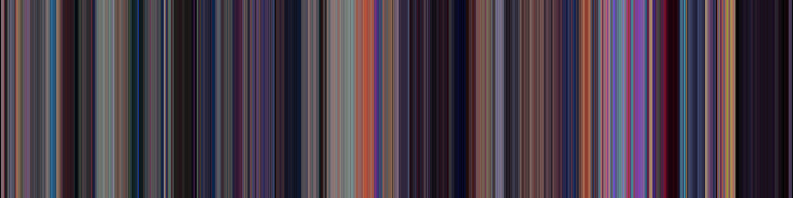
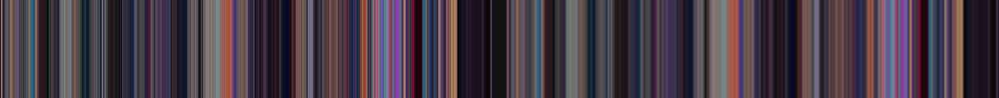

# 🎞️ Shape Of Movie

[](https://github.com/Fyndir/ShapeOfMovie/actions/workflows/ci.yml)


**Résumer un film entier en une seule image.** Shape Of Movie échantillonne une image par seconde, la réduit à une couleur, puis aligne toutes ces couleurs dans l'ordre chronologique : l'ambiance, les scènes de nuit, les changements de décor apparaissent d'un coup d'œil.


> Projet né en DUT en 2020, entièrement réécrit en 2026. Prochaines étapes : une interface web connectée à Jellyfin et un jeu « devine le film » (voir la [feuille de route](#-feuille-de-route)).

---

## ✨ Fonctionnalités

| | |
|---|---|
| 🎬 **Analyse de vidéos** | `.mkv`, `.mp4`, `.avi`, `.mov`, `.webm`… fichier seul ou dossier entier (récursif). Fonctionne aussi sur une URL de flux. |
| ⚡ **Rapide et sans fichiers temporaires** | ffmpeg décode et réduit les images en une seule passe, les pixels arrivent directement en mémoire. Environ 20× plus rapide que le temps réel sur du 1080p (≈ 5 min pour un film de 2 h). |
| 🎨 **4 méthodes de couleur** | moyenne, moyenne en lumière linéaire, médiane, couleur dominante (k-means). |
| 🖼️ **3 styles de rendu** | code-barres horizontal, bandes verticales, anneau. Taille libre et lissage optionnel. |
| 💾 **Format JSON léger** | une couleur hexadécimale par échantillon + métadonnées. Les fichiers de la version 2020 restent lisibles. |
| 🔁 **Reprise sûre** | les films déjà analysés sont ignorés ; un fichier n'est écrit qu'une fois l'analyse terminée. |

---

## 🚀 Installation

Prérequis : Python ≥ 3.11 et [ffmpeg](https://ffmpeg.org/download.html) dans le `PATH`.

```bash
git clone https://github.com/Fyndir/ShapeOfMovie.git
cd ShapeOfMovie
pip install -e ".[kmeans]"     # [kmeans] ajoute la méthode "dominant" (scikit-learn)
```

## 🛠️ Utilisation

Le travail se fait en deux temps : **analyser** les vidéos (long, une seule fois) puis **dessiner** autant de rendus qu'on veut à partir des JSON (instantané).

### 1. Analyser

```console
$ shapeofmovie analyze ~/Vidéos/Films -o shapes/ --method linear
analyse Pulp Fiction.mkv
   37% (3573/9657)
```

| Option | Défaut | Rôle |
|---|---|---|
| `-o, --output` | `shapes/` | dossier des fichiers JSON |
| `-m, --method` | `mean` | `mean`, `linear`, `median` ou `dominant` |
| `-s, --step` | `1` | secondes entre deux échantillons |
| `-f, --force` | | ré-analyse même si le JSON existe déjà |

### 2. Dessiner

```console
$ shapeofmovie render shapes/ -o images/ --style ring --width 800 --smooth 9
Pulp Fiction.linear.json -> images/Pulp Fiction.linear.ring.png
```

| Option | Défaut | Rôle |
|---|---|---|
| `--style` | `barcode` | `barcode`, `vertical` ou `ring` |
| `--width` / `--height` | `1920` / `1080` | taille de l'image (l'anneau est carré, `--height` ignoré) |
| `--smooth` | `0` | fenêtre de moyenne glissante, en échantillons |

### Depuis Python

```python
from shapeofmovie import analyze, render

shape = analyze("Pulp Fiction.mkv", method="linear", step=1.0)
shape.save("pulp.json")
render(shape, style="ring", width=800).save("pulp.png")
```

---

## 🖼️ Styles de rendu

**`barcode`** : le temps s'écoule de gauche à droite.



| **`vertical`** : de haut en bas (le rendu de la version d'origine) | **`ring`** : dans le sens horaire, depuis midi |
|:---:|:---:|
|  |  |

**`--smooth`** atténue le scintillement des changements de plan (à gauche brut, à droite `--smooth 30`) :



## 🎨 Méthodes de couleur

| Méthode | Principe | Résultat |
|---|---|---|
| `mean` | moyenne des valeurs RGB | fidèle à la luminosité globale, un peu terne |
| `linear` | moyenne en lumière linéaire (sRGB → linéaire → sRGB) | proche du mélange perçu par l'œil, moins « boueux » |
| `median` | médiane par canal | ignore les petites zones très claires ou très sombres |
| `dominant` | plus gros groupe d'un k-means (k = 5) | la couleur qui occupe le plus de surface : plus contrasté, plus lent |


---

## 📄 Format JSON

```json
{
  "version": 2,
  "title": "Pulp Fiction",
  "method": "linear",
  "step": 1.0,
  "duration": 9216.4,
  "source": "/films/Pulp Fiction.mkv",
  "meta": {},
  "colors": ["1d1a17", "2b2420", "..."]
}
```

L'échantillon `i` correspond à l'instant `i × step` secondes. `meta` est libre (il accueillera par exemple l'identifiant Jellyfin). Les dix analyses d'origine sont fournies dans [`examples/`](examples/).

---

## 🧩 Architecture

```
src/shapeofmovie/
├── extract.py   # ffprobe / ffmpeg : échantillonnage des images, sans fichier temporaire
├── colors.py    # méthodes image → couleur
├── analyze.py   # pipeline vidéo → MovieShape, avec suivi de progression
├── models.py    # MovieShape + lecture/écriture JSON (compatible v1)
├── render.py    # MovieShape → image (barcode, vertical, ring)
└── cli.py       # commandes `analyze` et `render`
```

Le moteur n'a aucune dépendance à une interface : la ligne de commande, et bientôt l'application web, ne font que l'appeler.

## 🧪 Développement

```bash
pip install -e ".[dev]"
pytest                               # tests unitaires + bout en bout
ruff check . && ruff format --check .
python scripts/build_readme_images.py   # régénère les images de ce README
```

Les tests de bout en bout fabriquent une vraie vidéo avec ffmpeg (2 s rouge, 2 s vert, 2 s bleu), la passent dans la ligne de commande complète et vérifient les couleurs retrouvées et les images produites.

La CI GitHub Actions lance à chaque push et pull request :
1. **lint** : ruff (règles + formatage) ;
2. **test** : la suite complète sur Python 3.11, 3.12 et 3.13, puis la régénération des images du README ;
3. **build** : construction du paquet (wheel + sdist), installation dans un environnement neuf et test de fumée de la commande.

---

## 🗺️ Feuille de route

- [x] **v2 : moteur réécrit** (ffmpeg, numpy, 4 méthodes, 3 styles, CLI, tests, CI)
- [ ] **Application web** (FastAPI + Jinja + HTMX) : galerie, page par film avec survol de la timeline, lancement d'analyses avec progression en direct
- [ ] **Intégration Jellyfin** : connexion avec son compte Jellyfin, import de la bibliothèque, analyse automatique des nouveaux films
- [ ] **Jeu « Devine le film »** : retrouver un film de sa bibliothèque à partir de sa forme, avec des indices progressifs
- [ ] Image Docker et déploiement à côté de Jellyfin

## 📜 Licence

[GPL-3.0](LICENSE)
